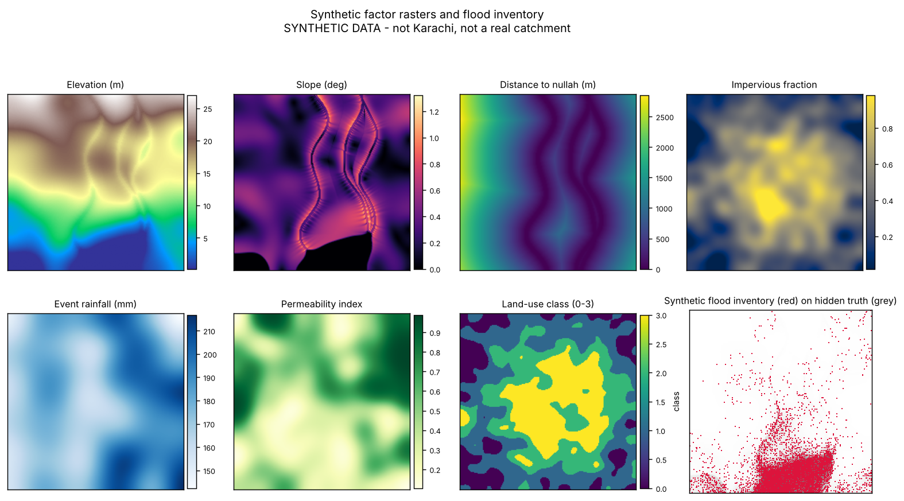
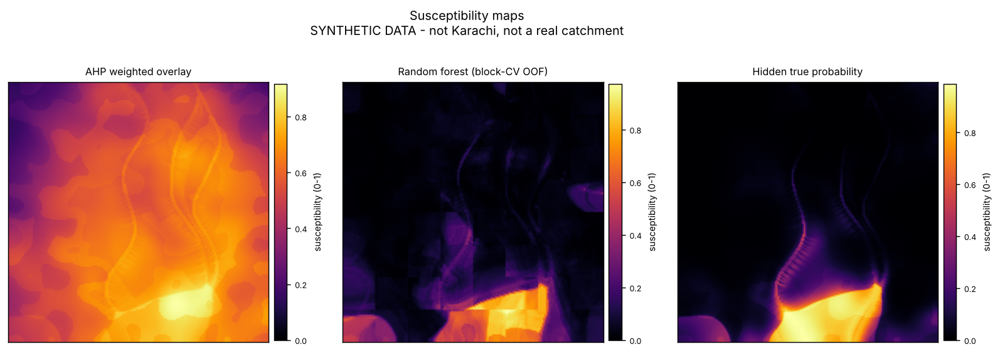
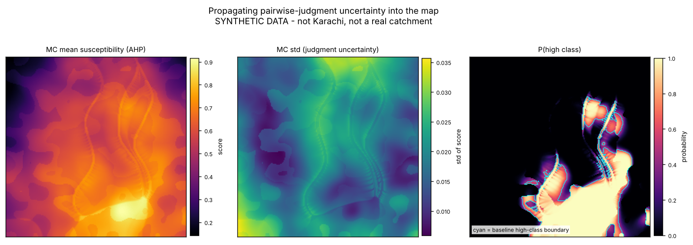
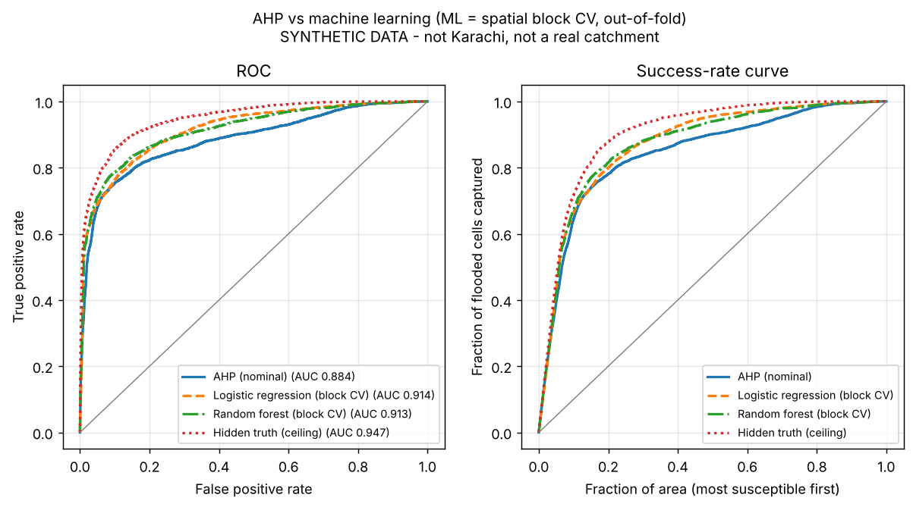
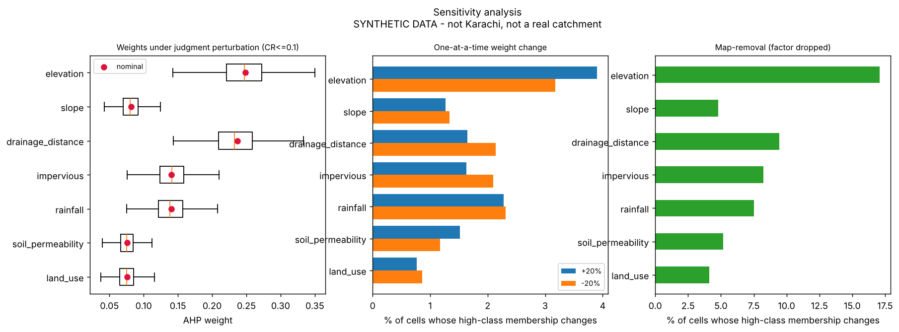

# Uncertainty-aware flood susceptibility mapping (AHP vs machine learning) — synthetic demonstration

> **All data in this repository are SYNTHETIC.** The catchment, the factor rasters and the flood
> inventory are generated by code (`src/floodunc/factors.py`). They are **not Karachi data** and do not
> describe any real place. The results show how the *methods* behave; they are **not** findings about
> Karachi or any real flood.

Author: Maheen Anwar (MSc GIS, University of Karachi). This is a portfolio project built around the
methodological questions of my MSc thesis on GIS/MCDA-based flood susceptibility mapping of Karachi:
how much should we trust a weighted-overlay susceptibility map when the expert judgments behind it are
uncertain, and how does it compare with a data-driven model that is validated honestly?

## Problem

AHP-based susceptibility maps are usually shown as a single map from a single set of pairwise judgments,
with a consistency ratio (CR) as the only quality statement. But judgments are subjective, the map
inherits that uncertainty, and the map is rarely validated in a way that respects spatial
autocorrelation. This repo tests a workflow that:

1. propagates uncertainty in the pairwise judgments into per-cell uncertainty and class probabilities,
2. quantifies factor importance with one-at-a-time and map-removal sensitivity analysis,
3. compares AHP with machine learning (random forest, logistic regression) using **spatial block
   cross-validation**, ROC/AUC, precision/recall and success-rate curves, against a flood inventory.

Because real inventories are never fully known, the demo uses a **synthetic 200 x 200 grid (30 m cells)**
whose flood inventory is drawn from a hidden nonlinear "true" susceptibility. That makes it possible to
check every step, including a "ceiling" score for the true surface.

## Method

| Step | Module | What it does |
|---|---|---|
| Synthetic catchment | `factors.py` | Seeded generator: elevation (smooth ramp + noise, channels carved), slope, distance to 3 meandering nullahs, impervious fraction (urban core), event rainfall, soil permeability, land use (4 classes). Hidden truth = nonlinear combination (exponential elevation decay, nullah proximity, slope sigmoid, rainfall x impervious interaction, permeability threshold) **plus an unobserved spatially correlated driver** that no model sees; inventory ~ Bernoulli(truth), tuned to ~10% flooded cells. |
| AHP | `ahp.py` | Pairwise matrix -> principal eigenvector weights, lambda_max, CI, CR (Saaty RI), weighted overlay of 0-1 criteria (higher = more flood-prone). |
| Uncertainty | `uncertainty.py` | Monte Carlo: each upper-triangle judgment is multiplied by `exp(sigma * N(0,1))` (sigma = 0.5), clipped to [1/9, 9], reciprocal restored; draws with CR > 0.1 are rejected. 1000 accepted draws give per-cell mean, std and P(high class). "High" = score above the baseline map's 80th percentile (a fixed cut-off, so P(high) is a real probability of crossing it). Also one-at-a-time (+/-20% on a weight, others rescaled) and map-removal sensitivity. |
| ML | `ml.py` | Random forest and logistic regression on the same 7 criteria; **spatial block CV**: 25 x 25-cell blocks assigned to 5 folds, plus a 5-cell buffer so training cells never touch the held-out region. Out-of-fold predictions are used for every map and metric. |
| Validation | `validate.py` | ROC/AUC, precision/recall for the top-20% area flagged "high", success-rate curve, 95% CI from a spatial block bootstrap. |
| Figures | `viz.py` | matplotlib only. |

The AHP judgments (`DEFAULT_PRIORITIES` in `ahp.py`) are rough expert-style guesses converted to Saaty
values. They were not tuned against the inventory.

## Run it

```bash
pip install -r requirements.txt
pytest -q                      # 17 tests
python scripts/run_demo.py     # ~1-2 min; writes figures, outputs/results.txt, outputs/susceptibility_cells.csv
```

`outputs/susceptibility_cells.csv` has columns `x, y, ahp, ahp_std, p_high, rf` (`rf` = out-of-fold
random-forest probability).

## Results (copied from `outputs/results.txt`; seed 42, 40,000 cells, 3,929 flooded = 9.82%)

**AHP.** lambda_max = 7.0470, CI = 0.0078, **CR = 0.0059**. Weights: elevation 0.248, drainage distance
0.237, impervious 0.141, rainfall 0.141, slope 0.082, soil permeability 0.076, land use 0.076.

**Monte Carlo on judgments (sigma = 0.5).** 1000 accepted draws from 1301 (acceptance 76.9%); accepted
CR mean 0.0660, max 0.0999. Weight sd ranges from 0.015 (permeability, land use) to 0.038 (elevation).
Per-cell std of the score: mean 0.0184, 95th percentile 0.0282, max 0.0357. High-class threshold 0.6784.
Cells with P(high) > 0.5: 19.92% of area (baseline high class: 20.00%). Cells with 0.1 < P(high) < 0.9:
**13.93%** of the area; P(high) >= 0.99 for 9.98% and <= 0.01 for 67.15%. The AUC of the 1000 perturbed
maps against the inventory has mean 0.8811 and 5-95% range [0.8607, 0.8985] (nominal map: 0.8842).

**Sensitivity (nominal weights).**

| Factor | OAT -20%: % cells changing class | OAT +20% | Map-removal: % cells changing class | Map-removal delta AUC |
|---|---|---|---|---|
| elevation | 3.18 | 3.90 | 17.08 | -0.1515 |
| drainage_distance | 2.14 | 1.65 | 9.46 | +0.0016 |
| impervious | 2.10 | 1.63 | 8.22 | +0.0070 |
| rainfall | 2.32 | 2.28 | 7.51 | +0.0102 |
| soil_permeability | 1.18 | 1.52 | 5.19 | -0.0112 |
| slope | 1.34 | 1.27 | 4.79 | -0.0156 |
| land_use | 0.87 | 0.77 | 4.12 | +0.0074 |

**Machine learning and the cost of leakage.** Random-forest AUC is 0.9391 with ordinary random 5-fold CV
but **0.9131** with spatial block CV, i.e. random CV overstates skill by 0.026 on this grid.

**Validation against the synthetic inventory** (top 20% of cells flagged high; random-guess precision =
prevalence = 0.0982; CI = block bootstrap):

| Model | AUC [95% CI] | Success-rate AUC | Precision | Recall |
|---|---|---|---|---|
| AHP (nominal) | 0.8842 [0.7940, 0.9354] | 0.8464 | 0.3836 | 0.7811 |
| Logistic regression (block CV) | 0.9142 [0.8473, 0.9449] | 0.8735 | 0.3928 | 0.7997 |
| Random forest (block CV) | 0.9131 [0.8415, 0.9449] | 0.8725 | 0.4005 | 0.8155 |
| Hidden truth (ceiling) | 0.9474 [0.9085, 0.9671] | 0.9034 | 0.4315 | 0.8786 |

### What I read from these numbers (about the methods, on synthetic data)

- With only moderately disagreeing judgments the class membership of about 14% of the area is uncertain,
  even though every sampled matrix is acceptably consistent (CR <= 0.1). A single CR does not tell you this.
- The uncertainty is not uniform: the std map concentrates along the channels, in the northern high ground and
  in the western margin (see figure 3).
- Map-removal shows elevation dominates (17% of cells change class, AUC falls by 0.15). Removing drainage
  distance, impervious, rainfall or land use barely changes AUC or slightly raises it, so AUC alone would not
  justify keeping them; their role here is as expert-plausible drivers, not demonstrated predictors.
- ML beats AHP by about 0.03 AUC and about 0.03 in success-rate AUC, but the AUC intervals overlap
  (they are marginal CIs, not paired). I would not claim a significant difference from one synthetic grid.
- The random-forest "importance" of slope (0.305) is largely because slope is derived from elevation (collinear);
  impurity importances are descriptive only.

### Figures

| | |
|---|---|
|  | Synthetic factors, inventory over the hidden truth |
|  | AHP, random forest (out-of-fold) and the hidden true probability |
|  | MC mean, std and P(high class) |
|  | ROC and success-rate curves |
|  | Weight spread, OAT and map-removal |

## Limitations

- **Synthetic data only.** The terrain, factors and inventory are generated, with smooth Gaussian-filtered
  fields; real data have noise, artefacts, mapping error and incomplete inventories. Results show method
  behaviour, **not Karachi findings**.
- **AHP weights here are expert-style guesses**, not elicited from experts. I wrote the judgments knowing
  the broad structure of the generator, so the AHP-vs-ML comparison is **not a fair contest** of which method
  is better in practice, and the AUCs should not be quoted as such.
- The inventory is generated from the same factors (plus one hidden driver), so skill is partly by construction.
  The hidden-truth row is a ceiling, not an achievable target.
- The uncertainty model only perturbs pairwise judgments (log-normal, one sigma for all entries,
  independent entries, CR <= 0.1 rejection). It ignores uncertainty in the factor layers, in the criterion
  scaling (min-max with 1-99% clipping) and in the inventory. Rejection by CR narrows the spread slightly.
- The "high" class is the top 20% of area, an arbitrary choice; natural breaks or fixed thresholds would change
  P(high). The sigma value (0.5) is also a modelling choice; at sigma = 0.25 no draw was rejected and the
  per-cell std was about half as large.
- Single seed and single grid; no repeated simulations. Spatial block CV reduces but does not eliminate
  leakage (blocks of 25 cells, 5-cell buffer, spatial range of the noise set by the generator).
- ROC/AUC on a 10%-prevalence inventory treats each cell as independent; the CIs use a block bootstrap
  to partly account for this.

## Roadmap

- Swap in a **Sentinel-1 derived flood inventory** and **SRTM / Copernicus DEM** derived terrain factors for Karachi.
- Compare the **2020 and 2022 Karachi flood events** as separate inventories (temporal transfer test).
- Add **fuzzy AHP** and **best-worst method (BWM)** and compare how each propagates judgment uncertainty.
- Repeat over many synthetic seeds; add paired AUC tests and calibration (reliability) of P(high).
- Propagate factor-layer and inventory uncertainty, not only judgment uncertainty.

## Repository layout

```
src/floodunc/   factors.py ahp.py uncertainty.py ml.py validate.py viz.py
scripts/run_demo.py
tests/          AHP weights/CR, Monte Carlo, block-CV leakage, generator, metrics
docs/figures/   generated PNGs
outputs/        results.txt, susceptibility_cells.csv
```

## License

MIT, (c) 2026 Maheen Anwar.
